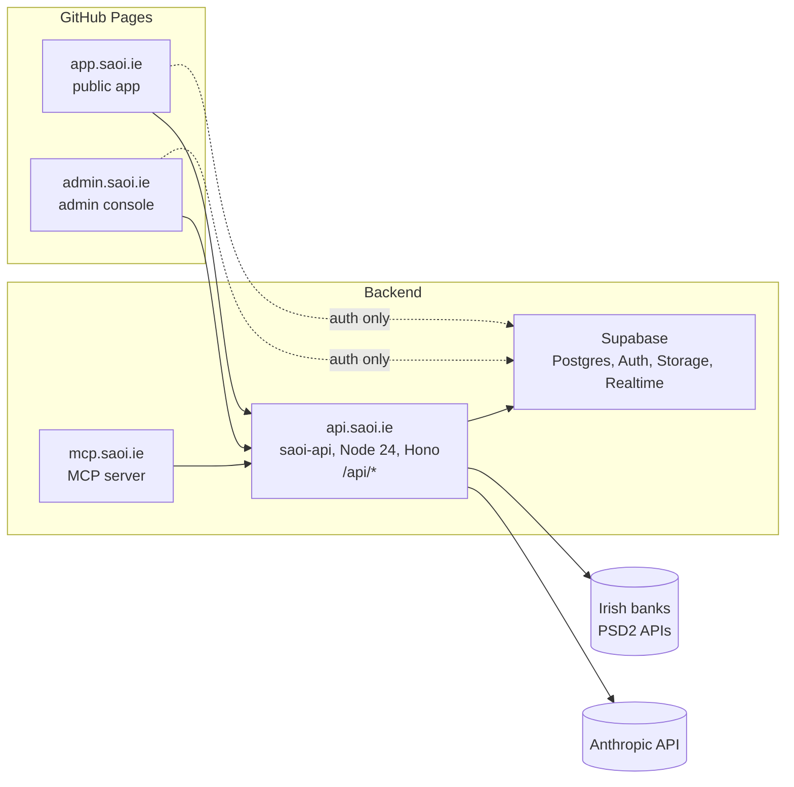

Saoi's business logic lives in API services. The same routines are reachable through an MCP server.
The Saoirse app is a front end with no business logic of its own, and the admin console is a separate
application. The open banking flows are mapped so the services are shaped for them.

:::note
This is the target shape. The migration is under way, so some pieces still run the old way. See
[Services](/architecture/services/) for what exists in code today.
:::

## Target shape

| Host               | What it is                                                                    |
| ------------------ | ----------------------------------------------------------------------------- |
| `saoi.ie`          | The landing page                                                              |
| `app.saoi.ie`      | The Saoirse chat, the public app (static, GitHub Pages)                       |
| `api.saoi.ie`      | The services: `/api/*` is `saoi-api`, everything else is the Supabase gateway |
| `mcp.saoi.ie`      | The MCP server                                                                |
| `docs.saoi.ie`     | These docs                                                                    |
| `showcase.saoi.ie` | The showcase, how it works, and the article                                   |
| `admin.saoi.ie`    | The admin console, once the app is split                                      |

The contract between them is the OpenAPI document that `saoi-api` publishes. The app, the admin
console and the MCP server generate their clients from it, so a breaking API change shows up as a
type error in the consumer at build time.

## The four calls

### 1. Runtime: self-hosted Supabase plus a Node service

There were three options. Plain Node means rebuilding auth, migrations tooling, storage, realtime
and backups. Staying on Edge Functions keeps the logic in Deno on a hosted project. The hybrid takes
the free parts of Supabase (Postgres, Auth, RLS as defence, Storage, Realtime) and puts the logic
in one long-running Node 24 container, `saoi-api`, next to it.

The account-information workload settles it. Consent renewal, metered unattended polling, mutual
TLS with a qualified certificate, request signing and long bank calls do not fit Edge Functions.
They fit a long-running process.

The framework is Hono with `@hono/zod-openapi`. The existing Zod contracts become the OpenAPI
document directly, and Hono is also one of the MCP SDK's adapters, so both servers share a shape.

### 2. Auth: Supabase Auth is the identity provider, the API verifies JWTs

Front ends sign in with Supabase Auth (anonymous, email code, and email and password for admins) and
send the JWT to `saoi-api`. The API verifies it, applies its own access checks, and writes with the
service role. The browser never reads a table directly. RLS stays as a second fence, not the first.

### 3. Contracts: OpenAPI, no shared package

Coupling through a published npm package keeps the coupling and adds a release step. Instead
`saoi-api` serves `openapi.json`, and the consumers run `openapi-typescript` to generate their
clients. The card schemas become response schemas in that document.

### 4. MCP: the official SDK, stateless, authless first

The MCP specification has moved on, and the TypeScript SDK v2 implements the current revision. The
server uses the SDK rather than hand-rolled protocol code. It serves both the new stateless path and
the legacy `initialize` path while clients catch up, and sits on its own host because OAuth
discovery lives at `/.well-known/` and a path prefix breaks that.

Phase one is authless, with public tools over synthetic data, so that Claude connectors can be
tested. OAuth 2.1 with audience binding comes before any tool sees consented bank data. See
[Use Saoirse from an agent](/mcp/using-saoirse-from-an-agent/).

## The open banking context

Inside `saoi-api` sits a bounded context, `open-banking`, built to a connector interface taken from
the PSD2 research. The finding that shapes it: AIB, Bank of Ireland and PTSB use the UK Open Banking
profile with redirect-only strong customer authentication, N26 is Berlin Group, and bunq has its own
API. So the interface is bank-neutral, and there are families of connectors rather than one standard.

The first connector is `demo`: the existing synthetic open-banking module behind the same interface.
That makes Demo Bank a real connector. The whole pipeline (consent state machine, scheduler,
encrypted store, audit log) can be built and tested before any certificate exists, and the showcase
keeps working. The second and third are bunq and N26, whose sandboxes can be reached without
registration. The three Irish incumbents need enrolment or certificates for their sandboxes, so they
come after the regulator pre-application.

More in the [open banking roadmap](/open-banking/roadmap/).
