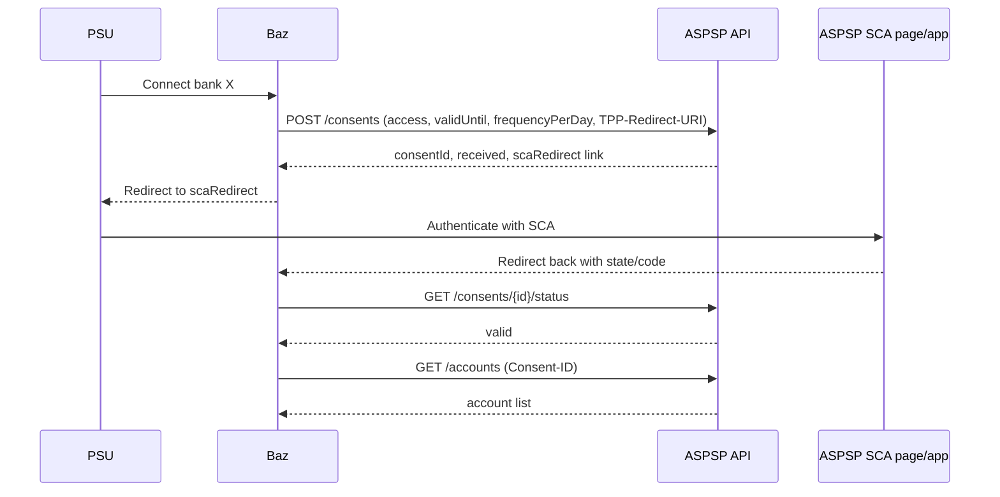
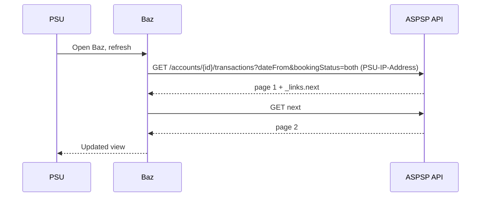
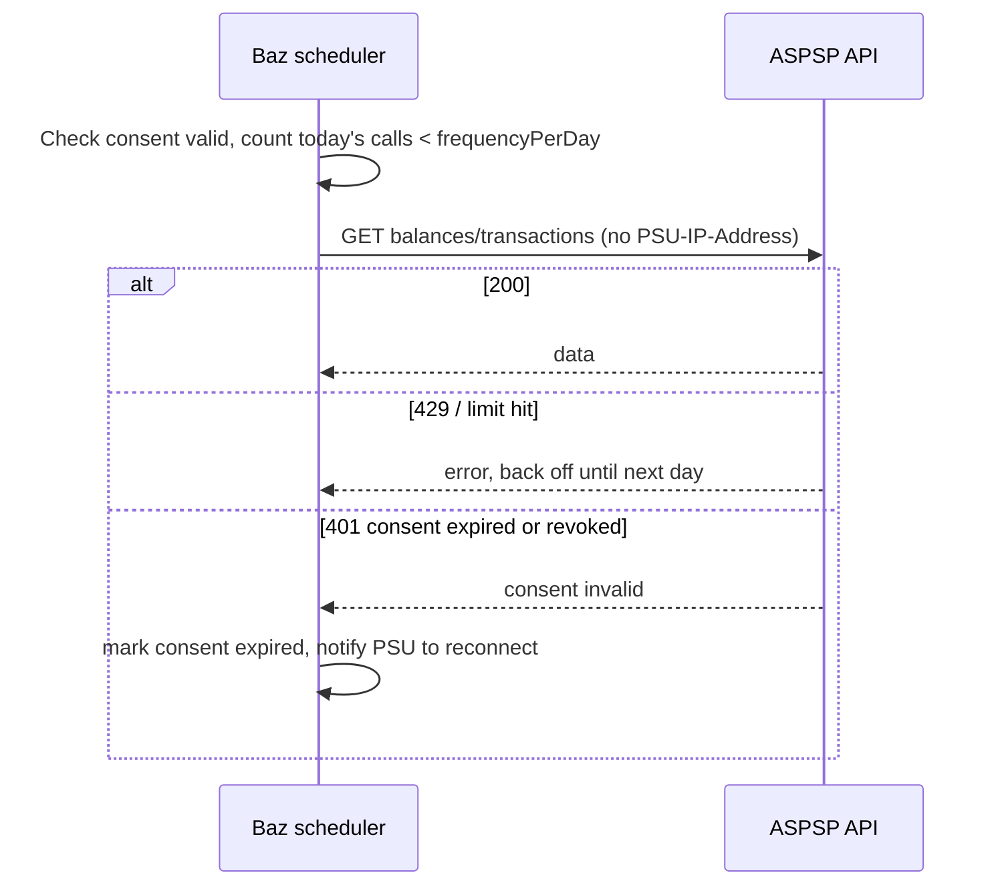
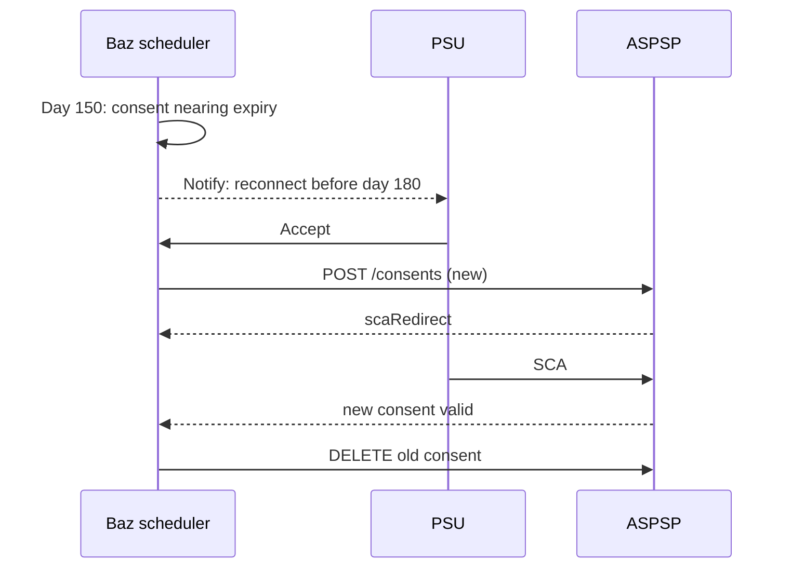
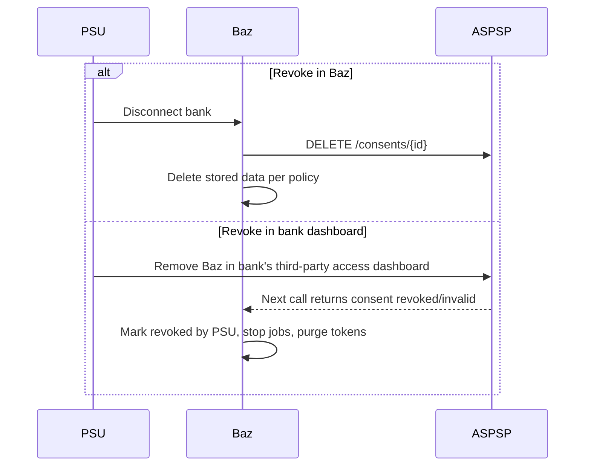
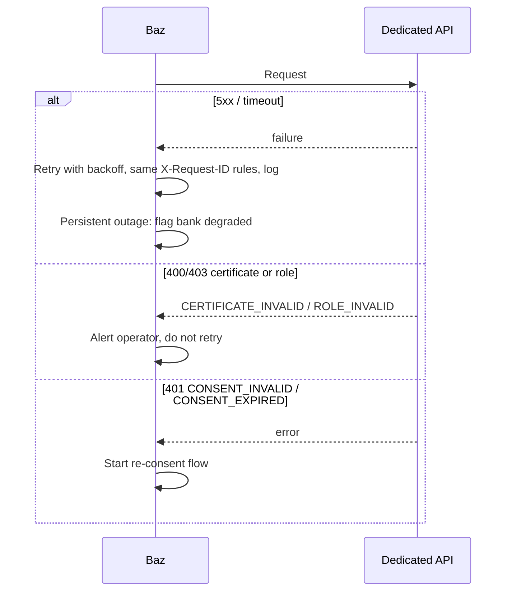
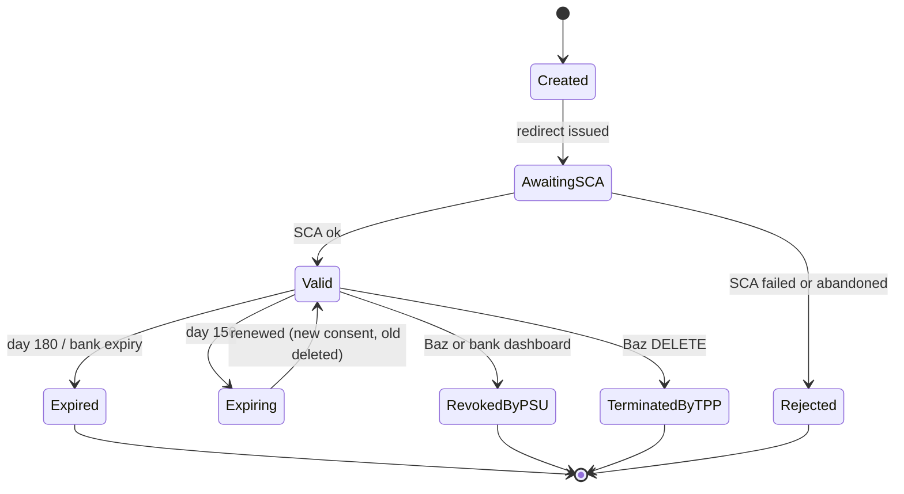

Baz is being shaped to read account data from Irish banks as a directly registered account
information service provider (AISP) with the Central Bank of Ireland, with no aggregator in between.

:::note
This is a plan, not a feature. Today Baz uses a synthetic Demo Bank connector only. Anything marked
**unconfirmed** could not be checked against a primary source.
:::

The headline finding: AIB, Bank of Ireland and PTSB do not use the Berlin Group standard. They use
the UK Open Banking Read/Write model (redirect only). So Baz needs at least two connector families,
and the connector interface below is bank-neutral.

## Roles and vocabulary

| Term                | Meaning                                                                                                                                                                   |
| ------------------- | ------------------------------------------------------------------------------------------------------------------------------------------------------------------------- |
| ASPSP               | Account Servicing Payment Service Provider: the bank holding the account.                                                                                                 |
| TPP                 | Third Party Provider: AISP, PISP or CBPII. Baz is an AISP (read only).                                                                                                    |
| AISP                | Account Information Service Provider: reads accounts, balances and transactions with the customer's consent.                                                              |
| PSU                 | Payment Service User: the end customer.                                                                                                                                   |
| Consent             | The PSU's authorisation for an AISP to read named accounts and data types, with an expiry and a frequency limit.                                                          |
| SCA                 | Strong Customer Authentication: two of knowledge, possession, inherence, done at the bank.                                                                                |
| QWAC                | Qualified Website Authentication Certificate: TLS client certificate, identifies the TPP on the connection.                                                               |
| QSealC              | Qualified Electronic Seal Certificate: signs request messages (HTTP Signature).                                                                                           |
| Dedicated interface | The API an ASPSP must build for TPPs under the regulatory technical standards (RTS), Art. 30 onward.                                                                      |
| Fallback            | Contingency access through the customer channel if the dedicated interface is down or unfit, unless the national authority has granted an exemption. Most banks have one. |

## Flows

### 3.1 First consent, redirect SCA



### 3.2 Attended fetch



### 3.3 Unattended refresh



### 3.4 Renewal at 180 days



Banks may expire consents earlier than Baz requests; always read the real status.

### 3.5 Revocation by the PSU



The bank-side dashboard exists because of the revised Payment Services Regulation proposal (PSR). Its final text and date of application are **unconfirmed** here. Baz should assume revocation can happen silently at any time and detect it on the next call.

### 3.6 Errors and fallback



Fallback screen scraping is not a design goal: Irish banks hold exemptions or expose none (**unconfirmed** per bank). Report persistent unavailability to the bank and the Central Bank under the RTS obligation to TPPs (Art. 33(3), spec of RTS, not re-read).

## What Baz must build

### Connector interface

One implementation per bank family: `BerlinGroup`, `UkOpenBanking`, `Bunq`. The first, for now, is
`demo`.

```ts
interface AisConnector {
  createConsent(i: {
    bankId: string;
    psuId: string;
    scopes: Scope[];
    validUntil: string;
    frequencyPerDay: number;
    redirectUri: string;
    state: string;
  }): Promise<{ consentId: string; status: ConsentStatus; authUrl: string }>;
  getConsentStatus(consentId: string): Promise<ConsentStatus>;
  listAccounts(consentId: string): Promise<Account[]>;
  getBalances(consentId: string, accountId: string): Promise<Balance[]>;
  getTransactions(
    consentId: string,
    accountId: string,
    q: {
      from?: string;
      to?: string;
      booking: 'booked' | 'pending' | 'both';
      cursor?: string;
      attended: boolean;
    },
  ): Promise<{ items: Transaction[]; next?: string }>;
  revokeConsent(consentId: string): Promise<void>;
}
type ConsentStatus =
  | 'received'
  | 'valid'
  | 'expired'
  | 'revoked_by_psu'
  | 'terminated_by_tpp'
  | 'rejected'
  | 'unknown';
```

The UK-profile connector maps `account-access-consent` to consent, and maps token refresh into
`getConsentStatus`.

### Consent state machine



### Planned API

The front end and the MCP server call these. MCP tools over bank data would be read-only wrappers.

| Endpoint                                       | Purpose                                     |
| ---------------------------------------------- | ------------------------------------------- |
| `GET /banks`                                   | Supported ASPSPs and capabilities           |
| `POST /consents`                               | Start connection; returns `authUrl`         |
| `GET /consents/callback`                       | Redirect landing; finalise and verify state |
| `GET /consents`, `GET /consents/{id}`          | List and status, with days to expiry        |
| `DELETE /consents/{id}`                        | Disconnect                                  |
| `POST /consents/{id}/renew`                    | Start renewal                               |
| `GET /accounts`, `GET /accounts/{id}/balances` | Cached reads                                |
| `GET /accounts/{id}/transactions`              | Paged, filters from, to, status             |
| `POST /sync`                                   | Attended refresh (counts as PSU-present)    |

### Storage and metering

Transactions and balances are encrypted at rest. Consent records are kept, tokens go in a secret
store, and the QSealC key belongs in an HSM or equivalent. The scheduler must meter calls per consent
per day.

### Logging

Logging for the regulator's incident and access reporting is inferred from the RTS and EBA incident
guidance. Central Bank specific AISP templates are **unconfirmed**. The plan is to log, without
payload data:

- per outbound call: timestamp, bank, consent id (hashed PSU id), `X-Request-ID`, endpoint, status,
  latency
- consent lifecycle events, with the actor (PSU, bank, Baz)
- SCA outcomes
- certificate use and renewals
- ASPSP unavailability and error rates (RTS Art. 33 reporting)
- security incidents and personal-data breaches (GDPR 72 hours; PSD2 major incident reporting for
  AISPs where applicable is **unconfirmed** in scope)
- admin access to data
- evidence of consent and its 180-day renewals

:::caution[To be written]
Irish bank by bank detail, registration steps and certificates are covered in the source research but
are not published here yet.
:::
